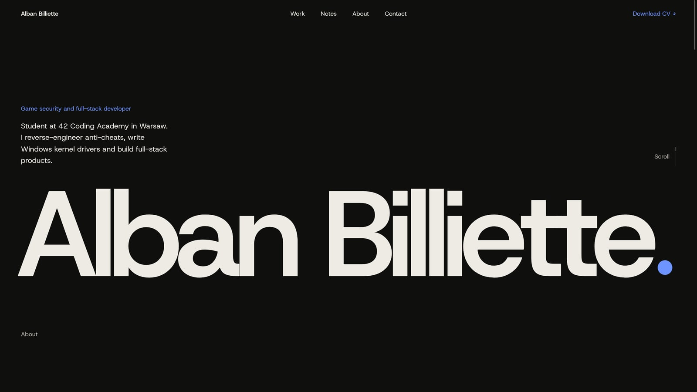

# Alban Billiette · Portfolio

My personal site at **[kaveo.dev](https://kaveo.dev)**: game security and full-stack work, case studies and notes.



A static [Astro](https://astro.build) site with no UI framework. Its centrepiece is a WebGL glass lens that
follows you down the page and refracts whatever it passes over. On the landing page it doubles as the full
stop after my name.

## How the lens works

The lens doesn't capture pixels from the page. It redraws the text under it onto a 2D canvas, using each
element's computed styles and the browser's own word positions (Range rects), then a WebGL shader refracts
that canvas through a glass shape that morphs from section to section. Only the area under the lens is drawn,
so it stays cheap, and the page underneath remains real, selectable HTML.

It lives in [`src/scripts/lens.js`](src/scripts/lens.js). Elements opt in with a `data-lens` attribute.

## What's inside

- **Home page** generated from a design export: [`design/Lens Portfolio.dc.html`](design/) holds the markup,
  styles and lens code, and [`tools/sync-design.py`](tools/sync-design.py) turns it into the Astro page, its
  CSS and scripts. Edit the design, not the generated files.
- **Case studies** (`/work/<name>/`) and **notes** (`/notes/<name>/`) written in Markdown as Astro content
  collections. Every field is described in [`src/content.config.ts`](src/content.config.ts).
- **Images sized for each screen:** note screenshots are built as AVIF with a srcset, and case-study covers
  get a 1100px version for phones.
- **Phones and tablets** have their own layouts and larger touch targets. Page transitions and scrolling
  respect `prefers-reduced-motion`.
- **Plain scripts** for page transitions, the mobile header and the hidden scrollbar, loaded before first paint.

## Run it

You need Node 22 (pinned in [`.node-version`](.node-version)) and Python 3 for the design sync.

```sh
npm install
npm run dev          # http://localhost:4321, drafts visible
npm run build        # static site in dist/
npm run preview      # serve dist/
npm run sync:design  # regenerate the home page after editing design/
```

There are no tests: `npm run build` is the check, and it fails on content that doesn't match the schema.

## Writing content

- **A note:** add `src/content/notes/<name>.md` with `title`, `date` and `tag` in the front matter
  (`description` and `draft: true` are optional). Put its images in `src/content/notes/images/`.
  The three latest notes appear on the home page automatically.
- **A case study:** add `src/content/projects/<name>.md` and its cover in `public/images/`. A cover
  `images/x.webp` gets a phone-sized `images/x-1100.webp` (and `.avif`) when that file exists.
  The Work cards on the home page are written in the design file, so add the new card there too.

Drafts (`draft: true`) show in `npm run dev` and are left out of the build.

## Layout

```
design/        design export the home page is generated from
tools/         sync-design.py
src/content/   notes and case studies (Markdown)
src/pages/     home (generated), work/, notes/, 404, and an unlinked phone preview
src/scripts/   lens and page scripts
public/        images, CV, and Cloudflare Pages _headers and _redirects
```

## Deploy

Cloudflare Pages builds every push to `main` (Astro preset, `npm run build`, output `dist`).
[`public/_headers`](public/_headers) sets caching and [`public/_redirects`](public/_redirects) sends the old
blog URLs to their notes.

## License

The code is under the [MIT license](LICENSE). The content (case studies, notes, screenshots, CV, the copy
on the home page, and my name and logo as branding) is all rights reserved; see
[CONTENT-LICENSE.md](CONTENT-LICENSE.md). If you build your own site from this code, please replace the
content with yours.
