> Note: _All clickable links on this post are opening in a new tab for better reader experience :)_

## What is a Kernel Driver ?

A kernel driver is a low-level software module that runs in <a href="https://en.wikipedia.org/wiki/Kernel_(operating_system)" target="_blank">Kernel</a> mode on the level 0 of the <a href="https://en.wikipedia.org/wiki/Protection_ring" target="_blank">Protection ring</a> responsible for managing or interfacing with hardware, Operating System's core functions or low-level system resources such as CPU instructions.

## Requirements

* Virtual machine to load the Driver. I personally use <a href="https://www.virtualbox.org/" target="_blank">VirtualBox</a> with <a href="https://www.microsoft.com/en-us/software-download/windows11" target="_blank">Windows 11 Pro</a> installed.


* On your main computer, install <a href="https://visualstudio.microsoft.com/" target="_blank">Visual Studio</a> with the <a href="https://learn.microsoft.com/en-us/windows-hardware/drivers/download-the-wdk" target="_blank">Windows Driver Kit</a> installed.

> Tip: _**I recommend you start downloading the ISO of Windows 11, which is a long process.**_

<b></b>

## Setup the project

Open Visual Studio and start by clicking on **Create a new project** on the right side of the homepage.

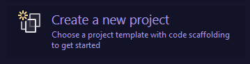

On the top right search bar type **KMDF**, choose **Kernel Mode Driver, Empty (KMDF)**, and click **Next**

> Warning: _If the Kernel Mode Driver, Empty (KMDF) is not available, start **Visual Studio Installer**, on the right side of your Visual Studio, click **Modify**, switch to the **Individuals components** tab, search for **Windows Driver Kit**, check it and install it._

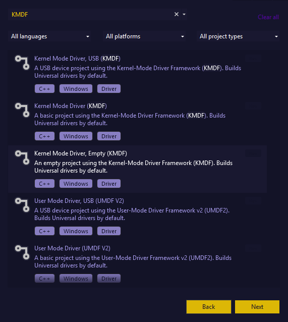

Now just choose in what folder to place your project and click on **Create**, you are now going to load the project.

Create the **main.c** file, left click on **Source Files** in the **Solution Explorer** then hover **Add** finally click **New Item...**

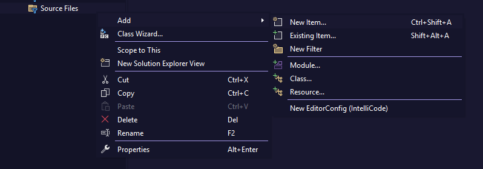

Just name the file as you want, I will personally name it **main.c** then finally click on **Add**

## Code the Driver

_Before you even start coding the Driver, **make sure to read everything**, even if it links to other pages. There's a purpose behind every link I include. **Reading is never useless**, it can only give you **more knowledge than you already have** !_

## Driver Entry

> Info: <a href="https://learn.microsoft.com/en-us/windows-hardware/drivers/kernel/driver-entry-points-in-driver-objects" target="_blank">Driver Entry</a> is the first routine called when a driver is loaded into the <a href="https://www.linfo.org/kernel_space.html" target="_blank">kernel space</a>. It's purpose is to initialize the **driver**. This is exactly like a ```main()``` function in C.

First of all, include <a href="https://learn.microsoft.com/en-us/windows-hardware/drivers/ddi/wdm/" target="_blank">wdm.h</a> on the top of your **main.c** file. Just keep in mind that it will be enough for basic driver handling. If you want to read and program high complexity **drivers** in the future, read about <a href="https://learn.microsoft.com/en-us/windows-hardware/drivers/ddi/_wdf/" target="_blank">wdf.h</a>

```c
#include <wdm.h>
```

Our **Driver Entry** prototype will start with <a href="https://learn.microsoft.com/en-us/openspecs/windows_protocols/ms-erref/596a1078-e883-4972-9bbc-49e60bebca55" target="_blank">NTSTATUS</a>, which is very useful to communicate with the <a href="https://en.wikipedia.org/wiki/Kernel_(operating_system)" target="_blank">kernel</a> and inform him whether our **driver** has successfully been loaded or not.

```c
#include <wdm.h>

NTSTATUS
```

Use **DriverEntry** keyword to define the main function. If you want to change this name, you have to **right-click on solution -> Properties -> Linker -> Advanced** and you can change the **Entry Point** and set any name that you want, I personally never changed it.

```c
#include <wdm.h>

NTSTATUS DriverEntry
```

Our first parameter type is a **PDRIVER_OBJECT**, which is a pointer to the actual <a href="https://learn.microsoft.com/en-us/windows-hardware/drivers/ddi/wdm/ns-wdm-_driver_object" target="_blank">DRIVER_OBJECT</a> structure. While you could use **DRIVER_OBJECT** directly, using a pointer is more efficient and is the correct approach when modifying <a href="https://learn.microsoft.com/en-us/windows/win32/sysinfo/kernel-objects" target="_blank">kernel objects</a>.

```c
#include <wdm.h>

NTSTATUS DriverEntry(
	PDRIVER_OBJECT DriverObject
)
```

Our second parameter type is used to store the **Registry Path** where driver configuration information is stored, we are not gonna use this parameter during this tutorial, but keep in mind that you will probably use it in high complexity **drivers**, so just **take the habit and add it**.

```c
#include <wdm.h>

NTSTATUS DriverEntry(
	PDRIVER_OBJECT DriverObject,
	PUNICODE_STRING RegistryPath
)
```
Considering we are not gonna use **RegistryPath** at all, just make sure to call the **UNREFERENCED_PARAMETER** macro by passing it as the first parameter, this is exactly the same as casting a void in **C**, e.g. ```(void) RegistryPath``` to avoid the compiler warning us.

```c
#include <wdm.h>

NTSTATUS DriverEntry(
	PDRIVER_OBJECT DriverObject,
	PUNICODE_STRING RegistryPath
)
{
	UNREFERENCED_PARAMETER(RegistryPath);
}
```
The most important part is of course to print our "**Hello World!**" In the debugger, to achieve this we are using <a href="https://learn.microsoft.com/en-us/windows-hardware/drivers/ddi/wdm/nf-wdm-dbgprint" target="_blank">DbgPrint</a> this is one of the most famous ways to print a message in the **kernel** debugger.

We could use <a href="https://learn.microsoft.com/en-us/windows-hardware/drivers/ddi/wdm/nf-wdm-dbgprintex" target="_blank">DbgPrintEx</a> to specify the **component (subsystem)** and **severity level** of the debug print (useful when filtering) or <a href="https://learn.microsoft.com/en-us/windows-hardware/drivers/ddi/wdm/nf-wdm-kdprintex" target="_blank">KdPrintEx</a>, which is **not compiled** when you are **building your driver in release mode**.

> Info: _When programming using <a href="https://en.wikipedia.org/wiki/Windows_API" target="_blank">Windows API</a> another version of your function suffixed by **Ex** means the **Ex**tended version of the function which is used when programming high complexity drivers._

```c
#include <wdm.h>

NTSTATUS DriverEntry(
	PDRIVER_OBJECT DriverObject,
	PUNICODE_STRING RegistryPath
)
{
	UNREFERENCED_PARAMETER(RegistryPath);
	DbgPrint("Hello World!\n");
}
```

Having a <a href="https://learn.microsoft.com/en-us/windows-hardware/drivers/ddi/wdm/nc-wdm-driver_unload" target="_blank">DriverUnload</a> routine is cleaner. In the same way as **RegistryPath**, there are no resources to clean up in this guide but it's **sending the signal to Windows** to say that the **driver is successfully unloaded**. More details in the [DebugView Setup](#debugview-setup) section.


> Tip: _You can jump to the [Driver Unload](#driver-unload) section if you want to code this function now, then come back here !_

The <a href="https://learn.microsoft.com/en-us/windows-hardware/drivers/ddi/wdm/nc-wdm-driver_unload" target="_blank">Driver Unload</a> routine is originally set to **NULL** when no function is pointed to this value, so I will add my **DriverUnload** function, which we are going to code [here](#driver-unload).

```c
#include <wdm.h>

NTSTATUS DriverEntry(
	PDRIVER_OBJECT DriverObject,
	PUNICODE_STRING RegistryPath
)
{
	UNREFERENCED_PARAMETER(RegistryPath);
	DbgPrint("Hello World!\n");

	DriverObject->DriverUnload = DriverUnload;
}
```

To end our DriverEntry function, make sure to add the return statement with a **STATUS_SUCCESS** code to **indicate the OS** that everything has **successfully been exited**.

> Info: <a href="https://learn.microsoft.com/en-us/openspecs/windows_protocols/ms-erref/596a1078-e883-4972-9bbc-49e60bebca55" target="_blank">Here</a> is all **NTSTATUS** values that you can use to inform the OS of the actual status.

```c
#include <wdm.h>

NTSTATUS DriverEntry(
	PDRIVER_OBJECT DriverObject,
	PUNICODE_STRING RegistryPath
)
{
	UNREFERENCED_PARAMETER(RegistryPath);
	DbgPrint("Hello World!\n");

	DriverObject->DriverUnload = DriverUnload;

	return STATUS_SUCCESS;
}
```

## Driver Unload

<a href="https://learn.microsoft.com/en-us/windows-hardware/drivers/ddi/wdm/nc-wdm-driver_unload" target="_blank">Driver Unload</a> is the routine called when a **driver is unloaded** from the <a href="https://www.linfo.org/kernel_space.html" target="_blank">kernel space</a>, mainly used to **free allocated resources** and **clean driver traces**.

> Warning: _Make sure to code the **DriverUnload** function above **DriverEntry** or just forward a declaration of the prototype for the compiler to know the function before calling it._

First of all, our **DriverUnload** prototype will start with <a href="https://learn.microsoft.com/en-us/windows/win32/wmisdk/void" target="_blank">VOID</a>, but why ? Because when Windows is calling the **DriverUnload** routine there is no return expectation this is a **one-way operation**. There is no way to cancel the unload if it fails.

```c
#include <wdm.h>

VOID

NTSTATUS DriverEntry(
	PDRIVER_OBJECT DriverObject,
	PUNICODE_STRING RegistryPath
)
{
	UNREFERENCED_PARAMETER(RegistryPath);
	DbgPrint("Hello World!\n");

	DriverObject->DriverUnload = DriverUnload;

	return STATUS_SUCCESS;
}
```

> Info: For the **DriverUnload** function you can use any name. Which is different for the **DriverEntry** defined in the <a href="https://en.wikipedia.org/wiki/Linker_(computing)" target="_blank">linker</a> settings of the project.

**DriverObject** is of course mandatory for the unload function. When the unload routine is called, the system will execute everything declared in the function which is freeing, **removing symlinks** and of course **cleaning** the **DriverObject** from <a href="https://www.linfo.org/kernel_space.html" target="_blank">kernel space</a>.

```c
#include <wdm.h>

VOID DriverUnload(
	PDRIVER_OBJECT DriverObject
)

NTSTATUS DriverEntry(
	PDRIVER_OBJECT DriverObject,
	PUNICODE_STRING RegistryPath
)
{
	UNREFERENCED_PARAMETER(RegistryPath);
	DbgPrint("Hello World!\n");

	DriverObject->DriverUnload = DriverUnload;

	return STATUS_SUCCESS;
}
```
To end the function, make sure to **UNREFERENCE** the **DriverObject** since we are not gonna free anything from it manually but the **OS** absolutely needs it to unload the driver, this is a **mandatory** prototype.

Add a <a href="https://learn.microsoft.com/en-us/windows-hardware/drivers/ddi/wdm/nf-wdm-dbgprint" target="_blank">DbgPrint</a> with any message that you want to appear before our driver leaves the <a href="https://www.linfo.org/kernel_space.html" target="_blank">kernel space</a>.

> Info: **_Here is the complete code of the driver, if there are some parts that you struggle to understand, make sure to read the docs that are linked or do your own research._**

```c
#include <wdm.h>

VOID DriverUnload(
	PDRIVER_OBJECT DriverObject
)
{
	UNREFERENCED_PARAMETER(DriverObject);
	DbgPrint("Goodbye World!\n");
}

NTSTATUS DriverEntry(
	PDRIVER_OBJECT DriverObject,
	PUNICODE_STRING RegistryPath
)
{
	UNREFERENCED_PARAMETER(RegistryPath);
	DbgPrint("Hello World!\n");

	DriverObject->DriverUnload = DriverUnload;

	return STATUS_SUCCESS;
}
```
## Driver Building

Before building the driver, make sure that the solution configuration is set to **Debug** and **x64** as shown in the picture below.


To build the driver, hit the **Build** button on the toolbar and click on **Build Solution** or use <kbd>Ctrl</kbd>+<kbd>Shift</kbd>+<kbd>B</kbd> shortcut.

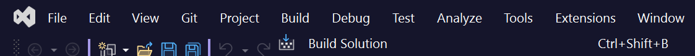

## Virtual Machine Setup

First make sure to turn off the secure boot on your virtual machine. On VirtualBox, go to **Settings**, make sure to switch on the **Expert** tab and uncheck the **Secure Boot**.

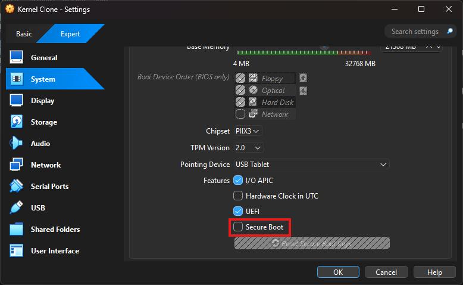

> Important: _After starting the virtual machine, open a command prompt in **elevated mode**, which is required for <a href="https://learn.microsoft.com/en-us/windows-hardware/manufacture/desktop/bcdedit-command-line-options?view=windows-11" target="_blank">bcdedit</a> commands._

The first command we are using is **mandatory** which, is basically turning on the kernel debugger. This is required for any kernel debugger.

```bash
bcdedit /set debug on
```
> Warning: Make sure to have **"The operation completed successfully."** Message after both commands.

The second command will allow us to **load our unsigned kernel driver** into the <a href="https://www.linfo.org/kernel_space.html" target="_blank">kernel space</a>. This is **mandatory** because our driver will **not be signed**. Official manufacturer's drivers are signed ones like **Intel**, **Nvidia**, **Anti-Cheats** and more... _Learn more about how to sign a driver <a href="https://learn.microsoft.com/en-us/windows-hardware/drivers/develop/signing-a-driver" target="_blank">here</a>_

```bash
bcdedit /set testsigning on
```
You can now **restart your computer**, make sure to have the <a href="https://learn.microsoft.com/en-us/windows-hardware/drivers/install/the-testsigning-boot-configuration-option" target="_blank">test mode</a> activated. You can find this on the **bottom left** of your **desktop**.

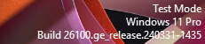

## DebugView Setup

> Info: _Before installing and setting up <a href="https://learn.microsoft.com/en-us/sysinternals/downloads/debugview" target="_blank">DebugView</a> which is the **kernel debugger** we're gonna use here, just keep in mind that I will not cover **advanced debugging** in this guide because it requires a very long process for **no reason**._

First of all, make sure to download **DebugView** by following <a href="https://learn.microsoft.com/en-us/sysinternals/downloads/debugview" target="_blank">this</a> link. Extract the **.zip archive** then move to the unzipped folder and drag **Dbgview** shown below it to your **desktop**.

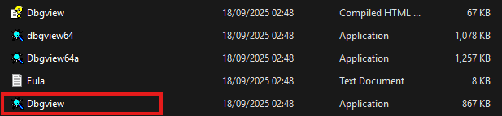

Next, right click on **Dbgview** previously dragged on your desktop switch to **Compatibility** tab then **Run this program as an administrator**, this is useful to always run as admin and being able to **capture the kernel**.

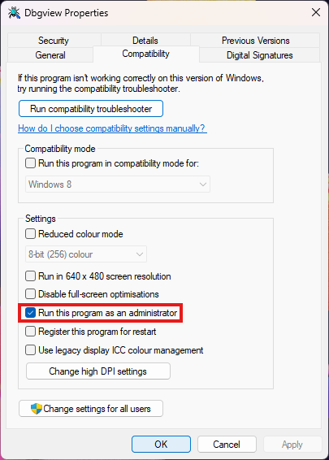

Run **DebugView** then on the toolbar select **Capture** and click on **Capture Kernel** as shown below or directly use <kbd>Ctrl</kbd>+<kbd>K</kbd> shortcut and **Enable Verbose Kernel Output** which is mandatory to see our debugging messages.

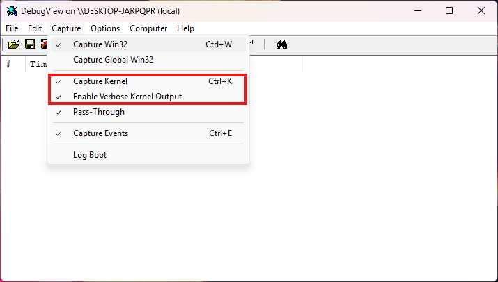

## Creating Service

> Info: _To load the driver we are going to use <a href="https://learn.microsoft.com/en-us/previous-versions/windows/it-pro/windows-server-2012-r2-and-2012/cc754599(v=ws.11)" target="_blank">sc.exe</a> which is the **services controller** on **Windows**. Our driver is considered a service we have to create it so we are able to **start/stop** it._

Go back to the **host computer** where driver is built **YourProjectName\x64\Debug** then copy the first folder which has **YourProjectName** and use virtual machine **Shared Clipboard** or **Drag and Drop** to paste it on virtual machine **desktop**.

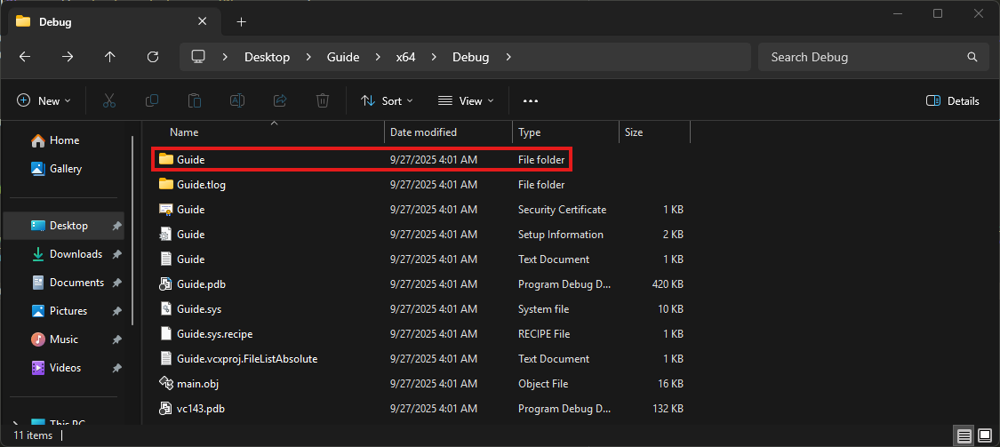

Once you have the path in your clipboard, open a command prompt in **elevated mode** and use **sc create** to create the driver using these 3 parameters :

1. The name of your service I will personally use **guide** you can use any name just **not a name that is already taken by another service**.
2. The type of our driver, which is logically a **kernel** for us, read more about **sc create** types <a href="https://learn.microsoft.com/en-us/previous-versions/windows/it-pro/windows-server-2012-r2-and-2012/cc990289(v=ws.11)" target="_blank">here</a> on the parameters table.
3. The path to your kernel's binary that you get by going in the moved folder and right-clicking **YourDriver.sys** then copy as path or using <kbd>Ctrl</kbd>+<kbd>Shift</kbd>+<kbd>C</kbd> shortcut.

```bash
sc create guide type="kernel" binpath="C:\Users\kaveO\Desktop\Guide\Guide.sys"
```
Make sure that you have **[SC] CreateService SUCCESS** message, which means that your service has **successfully been created** you are now able to **start and stop** it.

## Starting Driver

> Tip: _I recommend you split your screen into **two parts**, one with the **command prompt** to start/stop the driver and the other one with **DebugView** which is really useful to see your kernel driver messages in real time !_

To start the driver where we are using **sc start NameOfYourService**, the <a href="https://en.wikipedia.org/wiki/Service_Control_Manager" target="_blank">Service Control Manager</a> will call by himself <a href="https://learn.microsoft.com/en-us/windows-hardware/drivers/ddi/wdm/nf-wdm-zwloaddriver" target="_blank">ZwLoadDriver</a> which is gonna **load the driver into the memory** and **map it into the kernel space** then finally call the **DriverEntry** routine defined in our code which is gonna :

1. Print **"Hello World!"**
2. Setting up **DriverUnload** in **DriverObject**
3. Returning a **STATUS_SUCCESS**

```bash
sc start guide
```

> Note: _In case our driver fails to start, the **Service Control Manager** will set the service as failed to load and unload it._

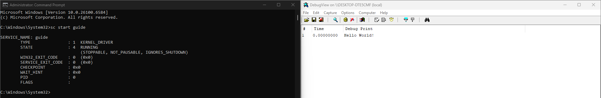

## Stopping Driver

To stop the driver simply use **sc stop NameOfYourService** who's is triggering <a href="https://en.wikipedia.org/wiki/Service_Control_Manager" target="_blank">Service Control Manager</a> that will trigger by himself <a href="https://learn.microsoft.com/en-us/windows-hardware/drivers/ddi/wdm/nf-wdm-zwunloaddriver" target="_blank">ZwUnloadDriver</a> which is **unmapping driver image from memory**, **dereferencing DRIVER_OBJECT** and **cleaning all related structures**.

> Note: _In case you have no **DriverUnload**, you could start the driver but having to **restart your computer if you want to unload it**. If you are programming high-complexity drivers into the future, just make sure to always have a **DriverUnload**. It's cleaner and more practical :)_

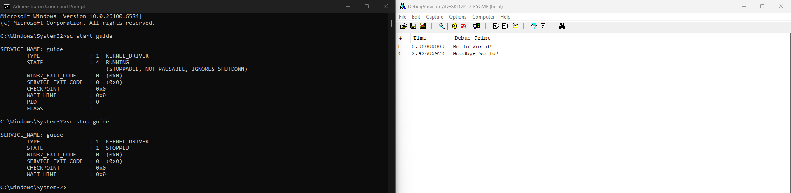

## End

**Thank you for reading me !**

_This is my first post on this blog. I tried to write readable sentences while only using reverso's **Grammar Checker** and really had fun while writing. I have a long process for personal projects which is normally impossible to do alone but this blog will be maintained for my whole programming journey._

**If you found an issue, something badly explained or a grammar error, message me on Discord. ```.kaveo``` I'm glad to fix that as soon as possible !**
