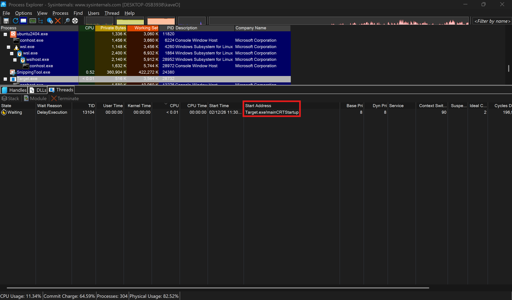
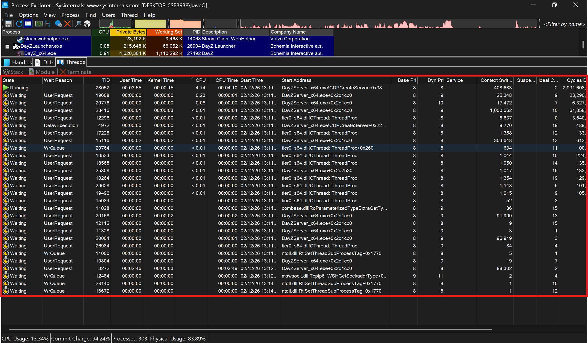
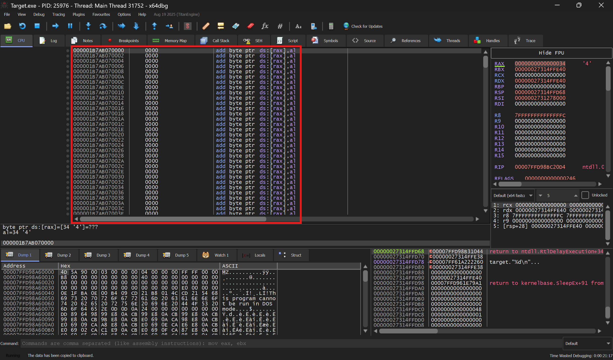
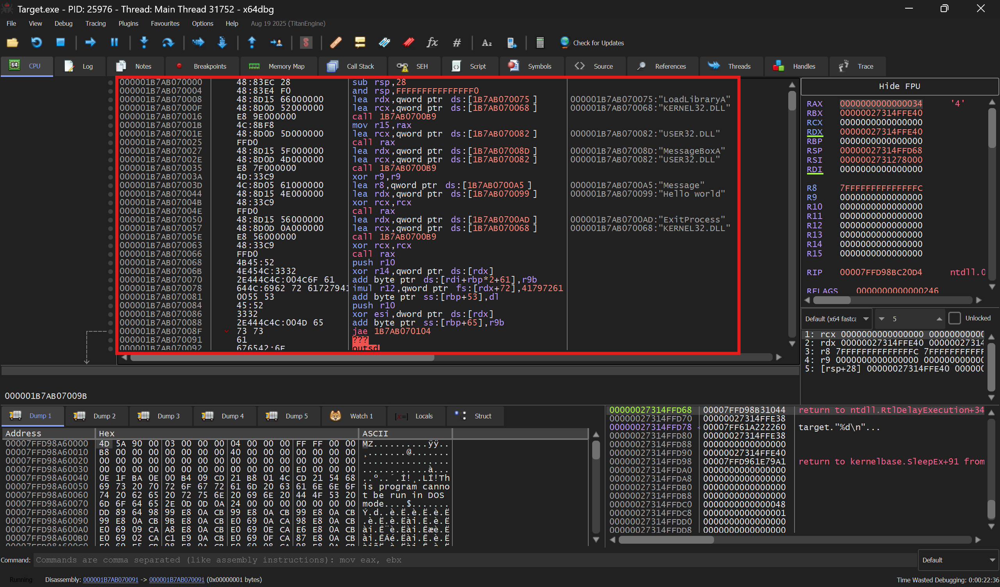

> Note: _All clickable links on this post are opening in a new tab for better reader experience :)_

## Thread vs Process

The most important knowledge in this articles is the difference between a **thread** and a **process** explained with my words below.

### <a href="https://en.wikipedia.org/wiki/Thread_(computing)" target="_blank">Thread</a>

A thread is a **sequence of instructions** scheduled by the operating system's <a href="https://en.wikipedia.org/wiki/Scheduling_(computing)" target="_blank">scheduler</a>. A process can contain multiple threads, and threads within the same process **share the process’s memory and resources** while maintaining their own execution context.

### <a href="https://en.wikipedia.org/wiki/Process_(computing)" target="_blank">Process</a>

A process is an **instance of a program in execution**. It may contain **one or more threads**. Processes are **isolated** from one another, and each process has its **own <a href="https://en.wikipedia.org/wiki/Virtual_memory" target="_blank">virtual memory</a> that is not shared** with other processes unless explicitly arranged (e.g., shared memory or IPC).

## The Difference

- **Processes run independently** of each other, while **threads exist within a process** and share that process’s resources.
- Processes are using **separate address space**, while **threads are sharing the same address space**
- <a href="https://en.wikipedia.org/wiki/Context_switch" target="_blank">Context switching</a> between **threads of the same process is faster** than between different processes because **threads share memory and resources**, whereas **processes require full context switching**.

## What is Thread Hijacking

Thread hijacking is a technique in which an attacker **takes control of an existing thread** within a process and **modifies its execution context** (such as the instruction pointer or stack) so that the **thread executes attacker-controlled code** instead of its original instructions.

## Why Shellcode Injection ?

There are different ways to hijack a thread, but I will cover the one that I used in this project which is the **shellcode injection technique** because this is the one that many people use when starting thread hijacking, the reason for that is **stability and ease of understanding**.

## Program Explanation

### Data Structure

Before diving deeper on how this technique can still be used to **bypass modern anti-cheats** and how to deal with it as a defender I will explain how my program works.

First of all I made a **HijackData structure** which is easier to store data. This structure looks like this

```c
typedef struct HijackData {
	const wchar_t	*processName;	// 8
	HANDLE			hProcess;		// 8
	HANDLE			c;		// 8
	DWORD			processId;		// 4
} t_HijackData;
```

* **processName** is the name of the process in which the target thread is located, required to find the process and **open an HANDLE**.
* **hProcess** is the HANDLE of the process; this is required to **allocate memory in the target**.
* **hThread** is the HANDLE of the target thread, required to **pause** the thread and change it **context**
* **processId** is the ID of the target process, required to **open a HANDLE** on the **target thread**.

### Find the target Process

The first function is simply looping between all processes and comparing their names with the **processName** variable. When found, the **processId** and **hProcess** to the target process are **saved in HijackData** structure. This is simply done using **Windows API** functions.

```c
static bool OpenTargetProcess(t_HijackData *data)
```

### Find the target Thread

The goal of this function is to open an HANDLE on the **main thread** of the target process. This is simply done by **looping all threads of the system** and breaking the loop when a thread whose processId is **strictly equal** to our **target processId** and finally **opening an HANDLE on this thread** and stocking it inside **HijackData** structure.

```c
static bool OpenTargetThread(t_HijackData *data)
```

As you can see in the **red square on the screenshot below**, only one thread is running in our target process, which is the **main thread**. This is making the task easier because when the loop is stopped, the **thread found is the only one running within our target process**, so logically the one that we want to hijack.



In the case we had a **process with multiple threads** that we wanted to hack, for example a **modern game** as shown on the **screenshot below** and wanted to hijack the **graphic rendering thread**, it would be harder because targeting a thread within a list of multiple of them require **pattern recognition** or thread **execution stack recognition**.



### Execute Hijacking function

The purpose of the **Hijack function** is to execute our previous functions and check if they successfully **executed** and **filled HijackData structure** and proceed to the thread hijacking by **allocating a virtual memory region** and **executing our shellcode** into this **previously allocated memory**.

```c
static bool Hijack(const wchar_t *processName, t_HijackData *data)
```

First of all, I allocated an **empty memory buffer** with the **size of shellcode** that I want to inject on this example. The **start address** of this buffer is **0x000001B7AB070000**. As you can see in the screenshot below, I used **x64dbg** to get a visual of the empty allocated memory inside our target process and for now **everything is empty**.



Once our memory is successfully allocated, we must prepair our allocated memory buffer in the target process by **writing our shellcode into the previously allocated memory space**, which is still the same with the start address **0x000001B7AB070000**. Of course, this **address is dynamic**, and if you try by yourself, it’s gonna change each time you restart the target/threat.

As you can see below, once **shellcode is injected** into the **allocated memory region**, the memory is **not empty anymore**, and **x64dbg** can **recognize the shellcode** content and add **comments** with **explicit functions calls**.

Seeing our memory not empty anymore and some **commented functions calls** means that now our **MessageBox shellcode is injected** into the previously allocated memory region in the target process and **ready to be executed**!



Now that our shellcode is successfully located in our target process, we must change our **thread stack execution** to make it **execute our shellcode** located inside our hijackBuffer.

To do that, we must retrieve our **thread context**, which is the "memory" of our thread, **stocking all the data** of it and especially the **Rip** register of our thread context, which is the **instruction pointer**, and changing this register value to our **hijackBuffer** to **execute the MessageBox**. This can be done in four steps.

1. I **paused the thread**, which is a very important step to **retrieve the context** properly and avoid the program **crashing** or retrieving a **broken** context.
2. I got the thread context by using **GetThreadContext**, it's **similar** to **making a snapshot** of the CONTEXT structure that I can modify.
3. After changing the **instruction pointer** of the context which is **Rip**, I changed the context inside the thread using **SetThreadContext**.
4. I finally **resumed** the thread to make sure that the thread execution resumed with our **new modified execution stack** to **pop the MessageBox**

> Note: _This is briefly explained in my words; if you want a deeper understanding of the program, just go on GitHub and read it. There are ~250 lines, and it's not complicated to understand!_

## Thread Hijacking in Modern Anti-Cheat Evasion

There are multiple ways to hijack a thread to **reduce detection** against most modern anti-cheats. While this technique can be effective, modern kernel-level anti-cheats are **constantly evolving** by implementing **additional telemetry** and **integrity checks** that make bypassing them really complex.

There are multiple ways to **evade anti-cheats detections** using thread hijacking, and I made a **list of some techniques** used by cheats programmers. Take note that these **techniques are old**, the most important thing is **your implementation** more than everything :)

- Thread **context redirection** to a cheat program code then resume the original thread execution stack.
- Directly **execute cheat code within a legitimate thread** context to avoid the injection of a potential **DLL** which has extremely high chances of getting detected.
- Since the technique is **not creating any threads** or processes, it can avoid triggering **ObRegisterCallbacks** and other **kernel filters** that **block handles**.
- Avoid **memory footprints** and **patterns detection** by simply executing cheat code and **clearing it** after execution.
- Manipulating **return addresses** of the thread execution stack using **Windows Thread Pool** and only **GetThreadContext/WriteProcessMemory** without pausing the thread.

## End

**Thank you for reading me !**

_This is my second post on this blog. I tried to write readable sentences while only using reverso's **Grammar Checker** and really had fun while writing. I have a long process for personal projects which is normally impossible to do alone but this blog will be maintained for my whole programming journey._

**If you found an issue, something badly explained or a grammar error, message me on Discord. ```.kaveo``` I'm glad to fix that as soon as possible !**
